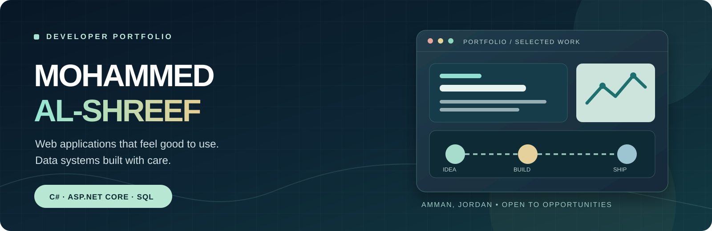
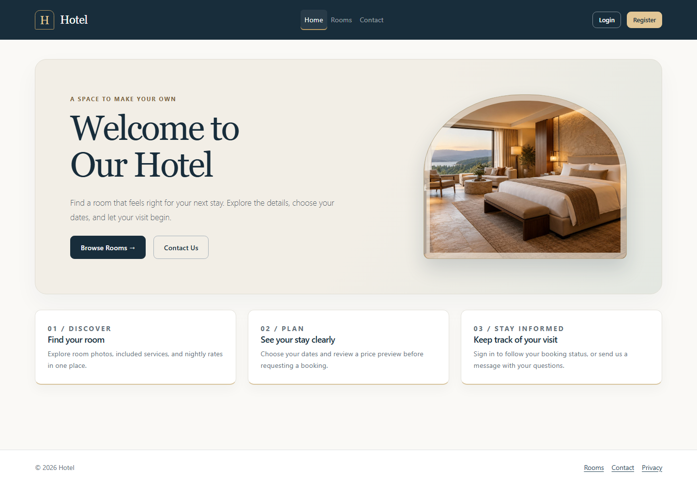
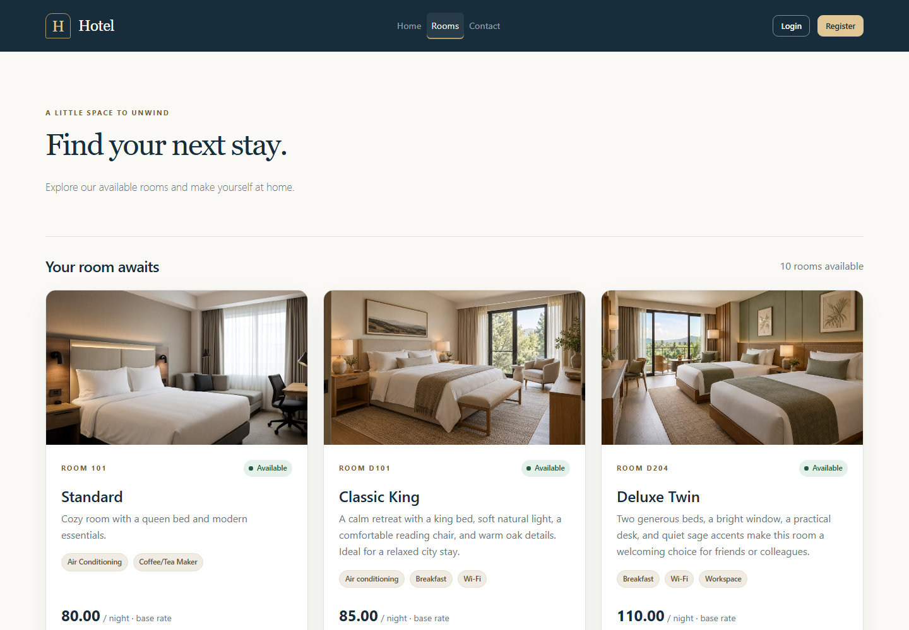
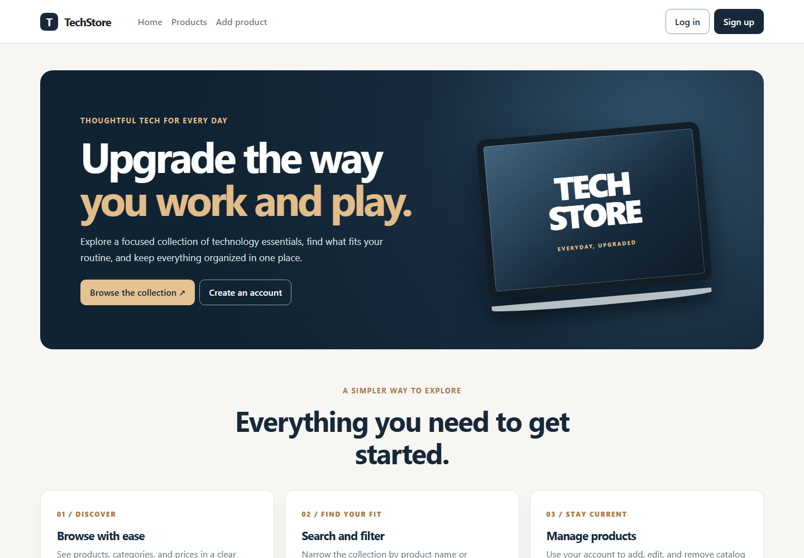
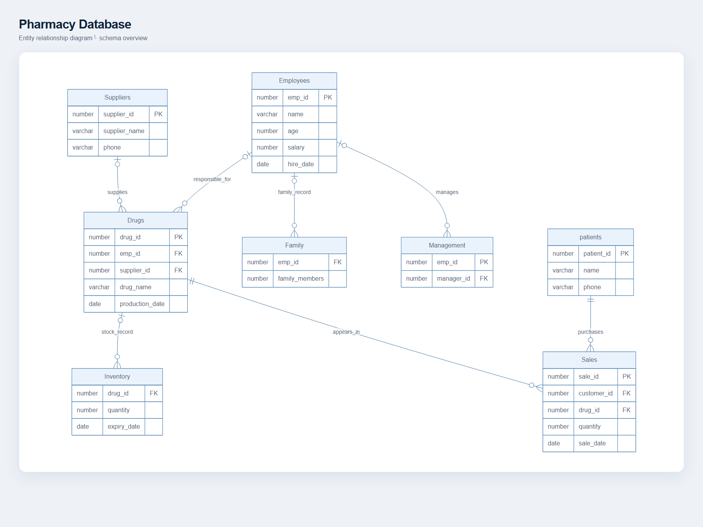
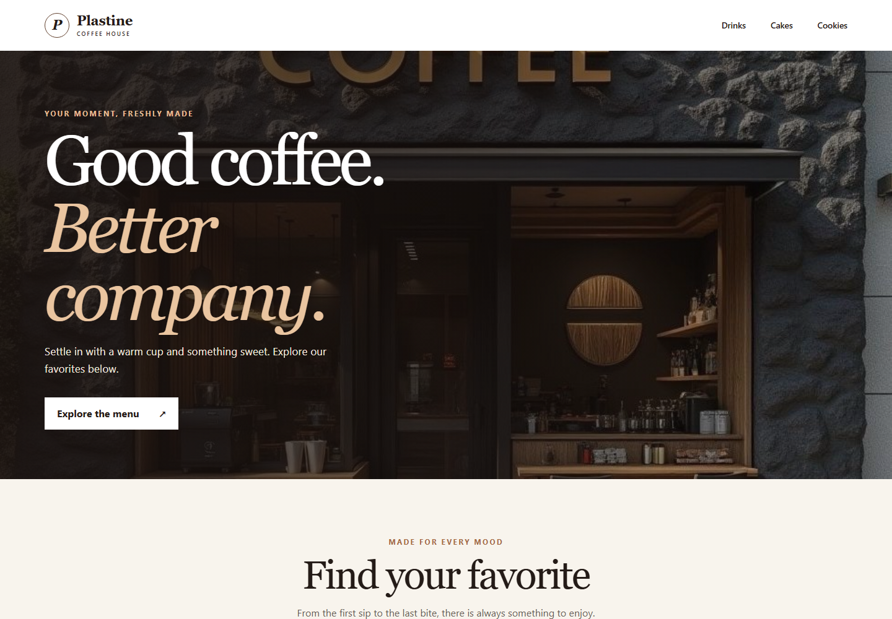

### Junior .NET Developer | C# · ASP.NET Core MVC · SQL Server

Computer Science student at **Zarqa University** · Amman, Jordan  
Seeking Junior .NET Developer roles and .NET internships

[Explore the projects](#selected-work) · [LinkedIn](https://linkedin.com/in/mohammed-al-shreef-375b87359) · [Email me](mailto:mhmdnymalshryf2@gmail.com)

## A little about me

I'm a Computer Science student building web applications with **C#, ASP.NET Core MVC, Entity Framework Core, and SQL Server**. My portfolio includes hotel booking, student and course management, a storefront demo, and relational database projects. These projects demonstrate MVC development, data modeling, authentication, validation, and responsive interfaces.

## Selected work

### 01 · [Hotel Management System](https://github.com/abonaeem657/Hotel-Management-System)

Room discovery and booking flows for customers, with administration tools for hotel operations. Includes role-based access, server-side pricing, and booking availability checks.

<table><tr><td width="50%"></td><td width="50%"></td></tr></table>

`ASP.NET Core MVC` · `EF Core` · `SQL Server` · `Identity`

[Watch the 38-second walkthrough →](https://abonaeem657.github.io/Hotel-Management-System/) · [See the code and setup →](https://github.com/abonaeem657/Hotel-Management-System)

### 02 · [CampusDesk: Student Course Management](https://github.com/abonaeem657/Student-Course-Management-System)

A student, course, and enrollment workspace with clear paths to each workflow and a responsive dashboard.

`ASP.NET Core MVC` · `EF Core` · `SQL Server LocalDB`

[Explore the project →](https://github.com/abonaeem657/Student-Course-Management-System)

### 03 · [TechStore E-Commerce](https://github.com/abonaeem657/techstore-ecommerce)

A responsive storefront with product search and filtering, account registration, and protected catalog management. Product data is held in memory for this portfolio demo.

<table><tr><td width="50%"></td><td width="50%"></td></tr></table>

`ASP.NET Core MVC` · `C#` · `Authentication` · `Razor`

[See the code and setup →](https://github.com/abonaeem657/techstore-ecommerce)

## Data modeling

These repositories are SQL projects, so their visuals are schema diagrams rather than application screenshots. Each diagram links to its source, SQL scripts, and setup notes.

| [Sales & Inventory Database](https://github.com/abonaeem657/Sales-Inventory-Database) | [Pharmacy Database](https://github.com/abonaeem657/pharmacy-database) |
| :---: | :---: |
|  |  |
| SQL Server · T-SQL · reporting | Oracle SQL · PL/SQL · relationships |

## A smaller experiment

[**Plastine Coffee House Menu**](https://github.com/abonaeem657/menu-for-coffeshop1) is a photo-led, responsive menu with a static version that opens directly in a browser.

## Toolkit

| Area | What I use |
| --- | --- |
| Applications | C#, ASP.NET Core MVC, Razor, Entity Framework Core |
| Interfaces | HTML, CSS, JavaScript, Bootstrap |
| Data | SQL Server, T-SQL, Oracle SQL, relational modeling |
| Workflow | Git, GitHub, Visual Studio, VS Code |

## Let's connect

I'm seeking Junior .NET Developer opportunities and .NET internships. [Email me](mailto:mhmdnymalshryf2@gmail.com) or connect on [LinkedIn](https://linkedin.com/in/mohammed-al-shreef-375b87359).
